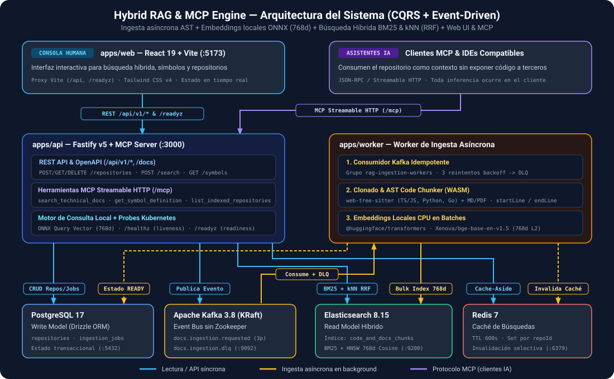
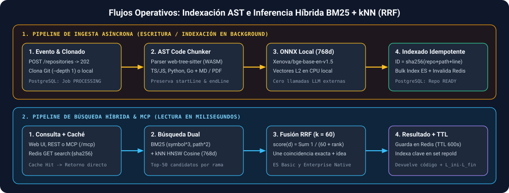

# 🧠 Hybrid RAG & MCP Engine Monorepo

**Plataforma privada de búsqueda inteligente para código fuente y documentación técnica**, diseñada con arquitectura orientada a eventos, procesamiento 100% local de inteligencia artificial en CPU y doble interfaz de acceso: **Consola Web interactiva** para equipos de ingeniería y **Servidor MCP (Model Context Protocol)** para asistentes de desarrollo.

---

## 🎯 Resumen Ejecutivo (¿Qué es y qué problema resuelve?)

En equipos de ingeniería con múltiples microservicios y documentación dispersa, encontrar rápidamente **dónde vive una regla de negocio** o **cómo funciona una función crítica** suele fallar por dos extremos:

1. 🔤 **Los buscadores tradicionales por texto** solo encuentran coincidencias literales: si buscas _"cálculo de puntuación"_ pero el código se llama `fuseWithRrf`, no aparece nada.
2. ☁️ **Las herramientas IA basadas en la nube** entienden conceptos, pero exigen enviar código fuente propietario a APIs externas de terceros y suelen cortar los archivos en bloques arbitrarios que pierden el contexto.

**Hybrid RAG & MCP Engine** resuelve ambos problemas combinando lo mejor de los dos mundos:

| Pilar de Valor                                   | Qué significa en la práctica                                                                                                                                                                                                                                    |
| :----------------------------------------------- | :-------------------------------------------------------------------------------------------------------------------------------------------------------------------------------------------------------------------------------------------------------------- |
| 🔒 **Privacidad Total (Zero External LLM SDKs)** | El backend **no instala ni importa** SDKs de modelos externos (`openai`, `anthropic`, `google/genai`, `langchain`). La comprensión semántica se calcula localmente en CPU mediante **ONNX** (`Xenova/bge-base-en-v1.5`), sin fuga de datos ni costes por token. |
| 🔀 **Búsqueda Híbrida Real (BM25 + kNN + RRF)**  | Fusiona coincidencia exacta de símbolos/archivos (**BM25**) con similitud conceptual vectorial (**HNSW 768d**) mediante **Reciprocal Rank Fusion**, devolviendo el fragmento exacto con archivo y líneas (`startLine`–`endLine`).                               |
| 🧩 **Fragmentación Inteligente por AST**         | En lugar de cortar archivos cada N caracteres, analiza el árbol sintáctico (**AST**) con `web-tree-sitter` en WebAssembly para extraer funciones, clases, interfaces y secciones Markdown/PDF completas.                                                        |
| 🖥️ **Doble Interfaz (Web + MCP)**                | Incluye una consola visual moderna (**React 19 + Vite + Tailwind CSS v4**) para uso directo en navegador y un endpoint **MCP Streamable HTTP** (`/mcp`) para integrarse nativamente con IDEs compatibles.                                                       |
| 🚀 **Preparado para Producción**                 | Separación **CQRS**, ingesta asíncrona resiliente con **Apache Kafka (KRaft) + DLQ**, caché selectiva en **Redis**, contenedores `node:22-slim` sin `root`, manifiestos **Kubernetes (Kustomize)** y pipeline CI/CD completo.                                   |

---

## 🛠️ Mapa de Competencias Técnicas Demostradas

| Área                               | Tecnologías y Patrones Aplicados                                                                                                                                                                                                            |
| :--------------------------------- | :------------------------------------------------------------------------------------------------------------------------------------------------------------------------------------------------------------------------------------------ |
| ⚙️ **Arquitectura & Backend**      | Node.js 22 LTS, TypeScript 5 (`strict`), Monorepo (`pnpm` workspaces + Turborepo), Fastify v5, validación de contratos con Zod v4, OpenAPI / Swagger, CQRS, Event-Driven Architecture                                                       |
| 🤖 **IA Aplicada & Search Engine** | Embeddings locales ONNX (`@huggingface/transformers`), Elasticsearch 8.15+ (analizador personalizado `camelCase`/`snake_case`, índice vectorial HNSW `768d` cosine), BM25 + kNN + RRF, Model Context Protocol (`@modelcontextprotocol/sdk`) |
| 🌳 **Parsing & Ingesta**           | AST Code Chunking (`web-tree-sitter` WASM para TypeScript, JavaScript, Python y Go), parser semántico Markdown y extracción PDF (`pdf-parse`), idempotencia determinista vía SHA-256                                                        |
| 💾 **Datos, Mensajería & Caché**   | PostgreSQL 17 + Drizzle ORM, Apache Kafka 3.8 en modo KRaft (sin Zookeeper, reintentos con _exponential backoff_ y Dead Letter Queue), Redis 7 (`Cache-Aside` con invalidación por repositorio)                                             |
| 🎨 **Frontend**                    | React 19, Vite, TypeScript, Tailwind CSS v4, Lucide Icons, cliente REST tipado, proxy de desarrollo, tests de interfaz con `@testing-library/react` + `jsdom`                                                                               |
| 🐳 **DevOps, Seguridad & QA**      | Docker multi-stage con `turbo prune`, usuario no privilegiado `node`, Kubernetes + Kustomize (Deployments, StatefulSets, HPA, Probes `/healthz` y `/readyz`), Vitest + Testcontainers, GitHub Actions (Trivy + Kind + GHCR), Biome          |

---

## 🏗️ Cómo Funciona el Sistema

<p align="center">
  
</p>

El sistema separa completamente la **ingesta pesada en segundo plano** (**Worker**) de las **consultas interactivas de baja latencia** (**API + Web + MCP**):

### 1. 📥 Cómo se indexa un proyecto (Flujo de Escritura Asíncrono)

1. 🌐 Desde la **Consola Web** (`http://localhost:5173`) o vía `POST /api/v1/repositories`, se registra un repositorio Git o directorio local.
2. 🐘 **`apps/api`** guarda el registro en **PostgreSQL**, crea un `ingestion_job` en estado `QUEUED`, publica el evento en **Apache Kafka** (`docs.ingestion.requested`) y responde al instante con `202 Accepted` sin bloquear al usuario.
3. 🌳 **`apps/worker`** consume el evento de forma asíncrona, marca el job como `PROCESSING`, clona el repositorio (`git clone --depth 1`) o lee el origen, y lo divide en unidades lógicas con su rango exacto de líneas (`startLine`–`endLine`).
4. 🧮 Convierte cada bloque en un vector numérico de **768 dimensiones** en CPU local, los indexa en **Elasticsearch** de manera idempotente (evitando duplicados si el proceso se reintenta), invalida automáticamente la caché previa del repositorio en **Redis** y marca el proyecto como `READY`.

### 2. ⚡ Cómo se realizan las búsquedas en milisegundos (Flujo de Lectura)

<p align="center">
  
</p>

1. 💬 Cuando un desarrollador consulta en la **Consola Web** o un asistente IA invoca una herramienta **MCP**, la petición llega a **`apps/api`**.
2. 🏎️ Primero se comprueba **Redis**: si la misma consulta ya se realizó recientemente para esa versión del repositorio, se devuelve al instante (`Redis Cache Hit`).
3. 🔎 En caso de `Cache Miss`, la consulta se vectoriza en CPU y lanza en **Elasticsearch** una doble búsqueda: **léxica (BM25)** priorizando nombres de símbolos (`symbolName^3`) y rutas (`filePath^2`), junto a una **búsqueda vectorial (kNN HNSW)**.
4. 📊 Ambos rankings se combinan con **Reciprocal Rank Fusion (RRF)**, se almacenan en Redis con TTL de `600s` asociados al `repositoryId` para futuras invalidaciones y se devuelven los fragmentos exactos listos para leer o copiar.

---

## 🧭 Decisiones Técnicas Clave

### 🗄️ CQRS y Persistencia Políglota

Cada motor de almacenamiento cumple una única responsabilidad óptima:

- **PostgreSQL 17 + Drizzle ORM (`packages/db`):** Fuente de la verdad transaccional para repositorios (`repositories`) e historial de ejecuciones (`ingestion_jobs`).
- **Elasticsearch 8.15+ (`packages/search`):** Modelo de lectura optimizado sobre el índice `code_and_docs_chunks`, combinando tokenización especial para identificadores de código (`camelCase` / `snake_case`) y vectores densos HNSW (`dims: 768`, `similarity: "cosine"`, `m: 16`, `ef_construction: 100`).
- **Redis 7 (`packages/cache`):** Patrón _Cache-Aside_ (`search:{sha256}`) con conjuntos por `repositoryId` para invalidar selectivamente únicamente la caché afectada tras una re-indexación o eliminación.

### 📐 Reciprocal Rank Fusion (RRF)

Para unir relevancia léxica y semántica sin calibrar escalas de puntuación incompatibles entre BM25 y similitud coseno, el motor calcula la puntuación combinada con ventana de ranking Top-50:

<p><code>score(d) = &Sigma; 1 / (60 + rank<sub>i</sub>(d))</code></p>

Este diseño garantiza compatibilidad total tanto con despliegues **Elasticsearch Basic/OSS** (fusión exacta en la capa de aplicación) como con **Enterprise/Platinum** (retriever nativo `rrf` activable mediante `ELASTICSEARCH_USE_NATIVE_RRF=true`).

### 📨 Apache Kafka 3.8 en Modo KRaft + Resiliencia

- Elimina la dependencia operativa de Zookeeper simplificando el despliegue local y en Kubernetes.
- El grupo de consumidores `rag-ingestion-workers` aplica reintentos automáticos con _exponential backoff_ (3 intentos) y desvío controlado de fallos irrecuperables al topic `docs.ingestion.dlq`.
- El identificador de documento en Elasticsearch usa un hash determinista `sha256(repoId + filePath + startLine + commitHash)` para garantizar idempotencia ante reentregas.

### 🛡️ Contenerización Segura y Pipeline CI/CD

- **Multi-stage Dockerfiles (`Dockerfile.api`, `Dockerfile.worker`):** Stage `pruner` con `npx turbo prune --docker`, compilación limpia en `installer` e imagen final `node:22-slim` ejecutándose como usuario no privilegiado `node` con pre-descarga del modelo ONNX para evitar latencias en arranque en frío.
- **GitHub Actions (`.github/workflows/ci.yml` & `cd.yml`):** Lint/Typecheck + Tests unitarios -> Tests E2E reales con **Testcontainers** -> Build Docker + auditoría de vulnerabilidades con **Trivy** -> Validación en clúster **Kind (Kubernetes in Docker)** con smoke test sobre `/healthz` -> Publicación en **GHCR**.

---

## 📦 Estructura del Monorepo

```text
hybrid-rag-monorepo/
├── .antigravity/             # Reglas de arquitectura y definición de endpoint MCP
├── .github/workflows/        # CI (Biome, Vitest, Testcontainers, Trivy, Kind) y CD (GHCR)
├── apps/
│   ├── api/                  # Fastify v5 REST API + Servidor MCP (/mcp) + OpenAPI (/docs)
│   ├── web/                  # Consola Web Interactiva (React 19 + Vite + Tailwind CSS v4)
│   └── worker/               # Consumidor Kafka + AST Chunker WASM + ONNX + Bulk Index ES
├── docs/
│   ├── assets/               # Diagramas SVG verificados incluidos en este README
│   ├── ARCHITECTURE.md       # Especificación de tablas PostgreSQL, eventos Kafka y mapping ES
│   └── ROADMAP.md            # Evolución y fases implementadas del proyecto
├── k8s/
│   ├── base/                 # Namespace, ConfigMap, Secret, Deployments, HPA y StatefulSets
│   └── overlays/             # Kustomize overlays (dev, prod)
├── packages/
│   ├── shared-types/         # Esquemas Zod (Env, DTOs REST, Eventos Kafka, Herramientas MCP)
│   ├── db/                   # Drizzle ORM (PostgreSQL 17) y repositorio CRUD
│   ├── events/               # Productor/Consumidor KafkaJS con reintentos y DLQ
│   ├── search/               # Cliente Elasticsearch, EnsureIndex y algoritmo RRF
│   ├── cache/                # Cliente Redis ioredis, Cache-Aside e invalidación selectiva
│   ├── embeddings/           # Singleton ONNX local (Xenova/bge-base-en-v1.5, 768d)
│   └── tsconfig/             # Presets estrictos de TypeScript 5
├── .env.example              # Variables de entorno por defecto para desarrollo local
├── docker-compose.yml        # PostgreSQL 17, Redis 7, Apache Kafka 3.8 KRaft, Elasticsearch 8.15
├── Dockerfile.api            # Imagen multi-stage optimizada para la API y servidor MCP
├── Dockerfile.worker         # Imagen multi-stage optimizada para el worker de ingesta
├── biome.json                # Reglas unificadas de linting y formateo
├── turbo.json                # Orquestación de builds, typecheck y lint cacheados
└── vitest.workspace.ts       # Separación de suites unit y integration
```

---

## 🚀 Inicio Rápido

### 📋 Requisitos Previos

- **Node.js** `>= 22.0.0`
- **pnpm** `12.x` (`corepack enable` o instalación directa)
- **Docker & Docker Compose** (con al menos ~3 GB de RAM disponibles para Elasticsearch y Kafka)

### 1️⃣ Instalar dependencias y levantar infraestructura

```bash
pnpm install
cp .env.example .env
docker compose up -d --wait
```

### 2️⃣ Sincronizar el esquema en PostgreSQL y compilar el monorepo

```bash
pnpm --filter @rag/db db:push
pnpm turbo build typecheck lint
```

### 3️⃣ Iniciar Backend (API + Worker) y Consola Web

Abre tres terminales en la raíz del proyecto:

```bash
# Terminal 1: API REST + Swagger + Servidor MCP (puerto 3000)
pnpm --filter @rag/api start

# Terminal 2: Worker de Ingesta Asíncrona (escucha Kafka)
pnpm --filter @rag/worker start

# Terminal 3: Consola Web React + Vite (puerto 5173)
pnpm --filter @rag/web dev
```

Una vez iniciados:

- 🖥️ **Consola Web:** `http://localhost:5173`
- 📖 **Documentación Interactiva API (Swagger):** `http://localhost:3000/docs`
- 🩺 **Health & Readiness Probes:** `http://localhost:3000/healthz` y `http://localhost:3000/readyz`
- 🤖 **Endpoint MCP (Streamable HTTP):** `http://localhost:3000/mcp`

---

## 🔌 Referencia Rápida de Interfaces

### 🌐 Endpoints REST (`apps/api`)

| Método   | Ruta                       | Descripción                                                                                  |
| :------- | :------------------------- | :------------------------------------------------------------------------------------------- |
| `POST`   | `/api/v1/repositories`     | Registra o re-indexa un repositorio en PostgreSQL y publica evento en Kafka (`202 Accepted`) |
| `GET`    | `/api/v1/repositories`     | Lista repositorios y el último `ingestion_job` asociado                                      |
| `DELETE` | `/api/v1/repositories/:id` | Elimina chunks en Elasticsearch, invalida caché Redis y borra el registro en PostgreSQL      |
| `POST`   | `/api/v1/search`           | Ejecuta búsqueda híbrida (`BM25 + kNN / RRF`) con caché en Redis                             |
| `GET`    | `/api/v1/symbols`          | Busca definiciones exactas por `symbolName`                                                  |
| `GET`    | `/healthz` / `/readyz`     | Sondeo de liveness y readiness contra PG, Redis, Elasticsearch y Kafka                       |

### 🧩 Herramientas MCP (`/mcp`)

- 🔍 `search_technical_docs`: Recupera fragmentos relevantes mediante búsqueda híbrida (`query`, `repositoryName?`, `language?`, `topK`).
- 🎯 `get_symbol_definition`: Localiza definiciones exactas de funciones, clases o interfaces por nombre de símbolo.
- 📚 `list_indexed_repositories`: Lista los repositorios en estado `READY` junto con su último commit indexado.

---

## 🧪 Testing y Verificación

```bash
# Suite unitaria completa (10 archivos de test across API, Web, Worker y Packages)
pnpm test:unit

# Suite de integración End-to-End con Testcontainers (requiere Docker daemon activo)
pnpm test:integration
```

La suite de integración levanta instancias efímeras reales de **PostgreSQL**, **Redis**, **Kafka** y **Elasticsearch**, verifica el flujo completo desde `POST /api/v1/repositories` hasta el consumo en el Worker, comprueba los resultados vía herramienta MCP `search_technical_docs` y valida que la segunda consulta impacte la caché de Redis (`cached: true`).
